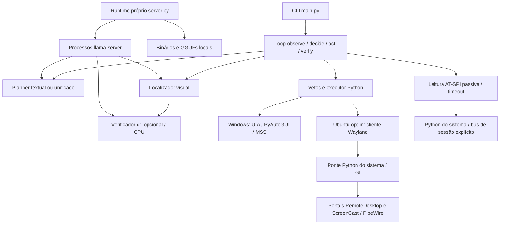

# Arquitetura

O loop observa a interface, consulta os modelos, aplica vetos e executa a ação escolhida.
O perfil B1 continua padrão; perfis e recursos experimentais exigem opt-in.

O runtime seleciona ZIP do Windows x64 ou tar.gz do Ubuntu x86_64, com backend CPU por padrão
e CUDA/Vulkan opcionais. A seleção do runtime Linux não habilita controle de desktop: o backend
Wayland continua explícito (`--platform wayland`). Nenhum teste unitário abre sessão de portal.
O verificador d1 usa endpoint configurado. Com `vision.verifier.auto_start: true` e URL local,
o runtime inicia um terceiro processo na CPU; sem esse opt-in, usa um servidor externo.

As baterias em `evals/` consultam servidores locais e avaliam respostas sobre dados congelados ou
simuladores. Não executam as ações de desktop e não demonstram sucesso end-to-end.
